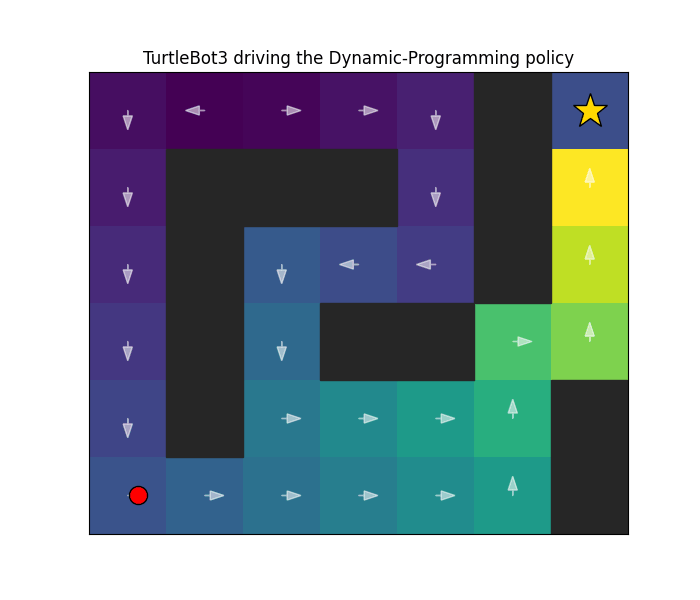
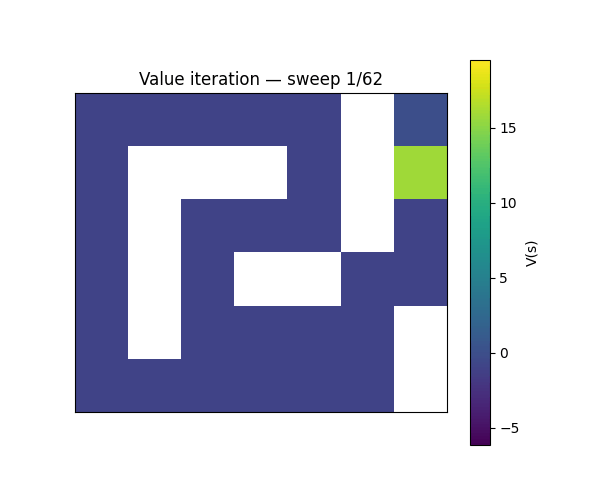
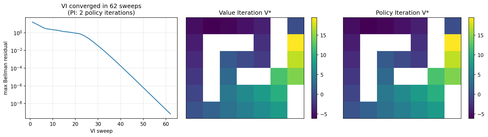

# rl-explorations

Applying reinforcement-learning fundamentals (Markov Decision Processes and Dynamic Programming) to robot navigation. A TurtleBot3 in Gazebo drives a path computed entirely by value iteration, over ROS 2.



The heatmap is the value function (brighter means closer to the goal), the white arrows are the optimal policy, and the red dot is the robot driving the path it computed.

## The idea

Value iteration, the core algorithm of Dynamic Programming, is essentially a classic robot path planner. This repo makes that literal: model a maze as a Markov Decision Process, solve it with Dynamic Programming, and hand the resulting policy to a robot.

## How it works

**1. Model the maze as an MDP and solve it with value iteration.** The value "floods" outward from the goal, sweep by sweep, until every cell knows how good it is:



**2. Cross-check with policy iteration.** Both Dynamic Programming algorithms reach the same optimal value function, by different routes:



**3. Drive the robot.** A ROS 2 node reads the robot's odometry, maps its pose to a grid cell, looks up the optimal action for that cell, and publishes a velocity command. Because it executes a *policy* (the best action from every cell, not a fixed route), the robot recovers naturally when it drifts off course.

## What's inside

- `gridworld/` — a pure-Python (numpy only) MDP and the DP solvers: iterative policy evaluation, value iteration, and policy iteration. Checked against the canonical Sutton & Barto Figure 4.1 grid and the Russell & Norvig 4x3 world.
- `viz/` — the matplotlib visualizations shown above.
- `ros2_ws/src/dp_nav/` — the ROS 2 / Gazebo demo. See its [README](ros2_ws/src/dp_nav/README.md) for the verified setup and run steps.
- `scenarios/` — the maze definition (grid layout, rewards, transition noise).

## Quick start

```bash
uv sync
uv run pytest        # the DP core, checked against the textbook answers
```

The robot demo (ROS 2 + Gazebo) is documented in [ros2_ws/src/dp_nav/README.md](ros2_ws/src/dp_nav/README.md).

## Scope

This uses the material from the first four chapters of Sutton & Barto: bandits, MDPs, and Dynamic Programming. Dynamic Programming plans with a known model; it does not learn from experience.
